# Poly Haven: Decor & Art models

**36 assets from [Poly Haven](https://polyhaven.com), dedicated to the public domain under [CC0](https://polyhaven.com/license).** Use them in any game, free or paid, and change them however you like; no credit is needed.

3D models as glTF at 1K and 2K texture resolution, each folder self-contained (`.gltf`, `.bin`, `textures/`). 212.2 MB in all.

This is a copy kept by [zuujis-cc0](https://github.com/zuujis-cc0) so game makers can take single files from GitHub. It is not made by or affiliated with Poly Haven: the originals, often in more formats and higher resolutions, are on [polyhaven.com](https://polyhaven.com). If they help you, consider [supporting Poly Haven](https://www.patreon.com/polyhaven/overview).

Every file is listed in [MANIFEST.tsv](MANIFEST.tsv) with its size and SHA-256. More free assets: [the Zuujis collection](https://github.com/zuujis-cc0/free-game-assets#readme).

| | | | |
| :-: | :-: | :-: | :-: |
| <a href="antique_ceramic_vase_01">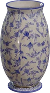</a> <b><a href="antique_ceramic_vase_01">Antique Ceramic Vase 01</a></b> by James Ray Cock · <a href="https://polyhaven.com/a/antique_ceramic_vase_01">source</a> |  <b><a href="brass_vase_01">Brass Vase 01</a></b> by Rico Cilliers · <a href="https://polyhaven.com/a/brass_vase_01">source</a> |  <b><a href="brass_vase_02">Brass Vase 02</a></b> by Rico Cilliers · <a href="https://polyhaven.com/a/brass_vase_02">source</a> |  <b><a href="brass_vase_03">Brass Vase 03</a></b> by Rico Cilliers · <a href="https://polyhaven.com/a/brass_vase_03">source</a> |
|  <b><a href="brass_vase_04">Brass Vase 04</a></b> by Rico Cilliers · <a href="https://polyhaven.com/a/brass_vase_04">source</a> | <a href="bronze_ray_statue">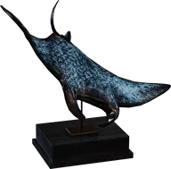</a> <b><a href="bronze_ray_statue">Bronze Ray Statue</a></b> by Tina · <a href="https://polyhaven.com/a/bronze_ray_statue">source</a> | <a href="bronze_shark_statue">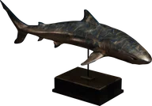</a> <b><a href="bronze_shark_statue">Bronze Shark Statue</a></b> by Tina · <a href="https://polyhaven.com/a/bronze_shark_statue">source</a> | <a href="bronze_whale_statue">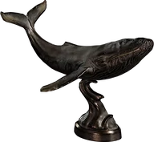</a> <b><a href="bronze_whale_statue">Bronze Whale Statue</a></b> by Tina · <a href="https://polyhaven.com/a/bronze_whale_statue">source</a> |
|  <b><a href="bull_head">Bull Head</a></b> by Tina · <a href="https://polyhaven.com/a/bull_head">source</a> |  <b><a href="carved_wooden_elephant">Carved Wooden Elephant</a></b> by Greg Zaal · <a href="https://polyhaven.com/a/carved_wooden_elephant">source</a> |  <b><a href="ceramic_vase_01">Ceramic Vase 01</a></b> by James Ray Cock · <a href="https://polyhaven.com/a/ceramic_vase_01">source</a> |  <b><a href="ceramic_vase_02">Ceramic Vase 02</a></b> by James Ray Cock · <a href="https://polyhaven.com/a/ceramic_vase_02">source</a> |
| <a href="ceramic_vase_03">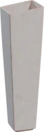</a> <b><a href="ceramic_vase_03">Ceramic Vase 03</a></b> by James Ray Cock · <a href="https://polyhaven.com/a/ceramic_vase_03">source</a> |  <b><a href="ceramic_vase_04">Ceramic Vase 04</a></b> by James Ray Cock · <a href="https://polyhaven.com/a/ceramic_vase_04">source</a> | <a href="chinese_screen_panels">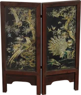</a> <b><a href="chinese_screen_panels">Chinese Screen Panels</a></b> by Kirill Sannikov · <a href="https://polyhaven.com/a/chinese_screen_panels">source</a> |  <b><a href="concrete_cat_statue">Concrete Cat Statue</a></b> by Rico Cilliers, Riley Queen · <a href="https://polyhaven.com/a/concrete_cat_statue">source</a> |
| <a href="fancy_picture_frame_01">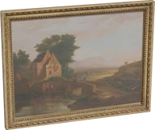</a> <b><a href="fancy_picture_frame_01">Fancy Picture Frame 01</a></b> by Rico Cilliers, Rob Tuytel · <a href="https://polyhaven.com/a/fancy_picture_frame_01">source</a> | <a href="fancy_picture_frame_02">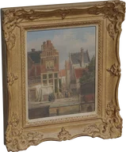</a> <b><a href="fancy_picture_frame_02">Fancy Picture Frame 02</a></b> by Rico Cilliers, Rob Tuytel · <a href="https://polyhaven.com/a/fancy_picture_frame_02">source</a> |  <b><a href="garden_gnome">Garden Gnome</a></b> by Bhargav Kubal · <a href="https://polyhaven.com/a/garden_gnome">source</a> |  <b><a href="gothic_statue">Gothic Statue</a></b> by Benny Weimer · <a href="https://polyhaven.com/a/gothic_statue">source</a> |
| <a href="hanging_picture_frame_01">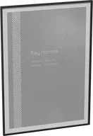</a> <b><a href="hanging_picture_frame_01">Hanging Picture Frame 01</a></b> by James Ray Cock · <a href="https://polyhaven.com/a/hanging_picture_frame_01">source</a> | <a href="hanging_picture_frame_02">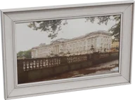</a> <b><a href="hanging_picture_frame_02">Hanging Picture Frame 02</a></b> by James Ray Cock · <a href="https://polyhaven.com/a/hanging_picture_frame_02">source</a> |  <b><a href="hanging_picture_frame_03">Hanging Picture Frame 03</a></b> by James Ray Cock · <a href="https://polyhaven.com/a/hanging_picture_frame_03">source</a> |  <b><a href="horse_head">Horse Head</a></b> by Tina · <a href="https://polyhaven.com/a/horse_head">source</a> |
|  <b><a href="horse_statue_01">Horse Statue 01</a></b> by Rico Cilliers · <a href="https://polyhaven.com/a/horse_statue_01">source</a> |  <b><a href="katana_stand_01">Katana Stand 01</a></b> by Rico Cilliers · <a href="https://polyhaven.com/a/katana_stand_01">source</a> | <a href="lambis_shell">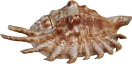</a> <b><a href="lambis_shell">Lambis Shell</a></b> by Kuutti Siitonen · <a href="https://polyhaven.com/a/lambis_shell">source</a> |  <b><a href="lion_head">Lion Head</a></b> by Tina · <a href="https://polyhaven.com/a/lion_head">source</a> |
|  <b><a href="marble_bust_01">Marble Bust 01</a></b> by Rico Cilliers · <a href="https://polyhaven.com/a/marble_bust_01">source</a> | <a href="ornate_mirror_01">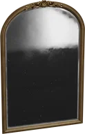</a> <b><a href="ornate_mirror_01">Ornate Mirror 01</a></b> by James Ray Cock · <a href="https://polyhaven.com/a/ornate_mirror_01">source</a> | <a href="planter_pot_clay">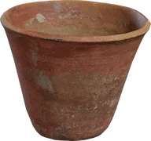</a> <b><a href="planter_pot_clay">Planter Pot Clay</a></b> by Amal Kumar · <a href="https://polyhaven.com/a/planter_pot_clay">source</a> | <a href="standing_picture_frame_01">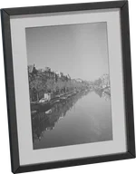</a> <b><a href="standing_picture_frame_01">Standing Picture Frame 01</a></b> by James Ray Cock · <a href="https://polyhaven.com/a/standing_picture_frame_01">source</a> |
| <a href="standing_picture_frame_02">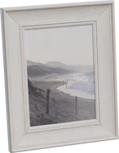</a> <b><a href="standing_picture_frame_02">Standing Picture Frame 02</a></b> by James Ray Cock · <a href="https://polyhaven.com/a/standing_picture_frame_02">source</a> |  <b><a href="throw_pillows_01">Throw Pillows 01</a></b> by Serhii Khromov · <a href="https://polyhaven.com/a/throw_pillows_01">source</a> | <a href="vintage_telephone_wall_clock">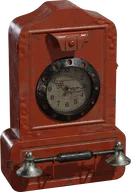</a> <b><a href="vintage_telephone_wall_clock">Vintage Telephone Wall Clock</a></b> by Adrian C · <a href="https://polyhaven.com/a/vintage_telephone_wall_clock">source</a> | <a href="wall_clock">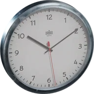</a> <b><a href="wall_clock">Wall Clock</a></b> by PierreB3D · <a href="https://polyhaven.com/a/wall_clock">source</a> |

---

Kept up to date by this repository's own [update workflow](.github/workflows/update.yml), with code and plan from [cc0-mirror](https://github.com/zuujis-cc0/cc0-mirror). Something wrong? [Open an issue there](https://github.com/zuujis-cc0/cc0-mirror/issues/new) or use the [private report form](https://games.zuujis.com/report).
